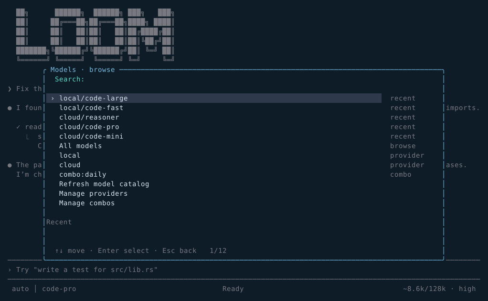
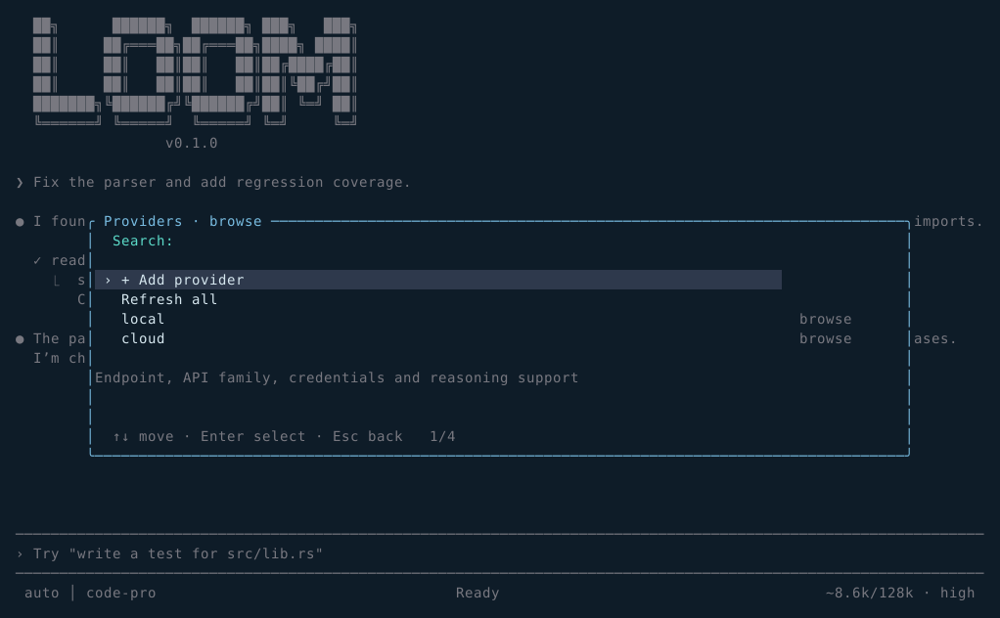
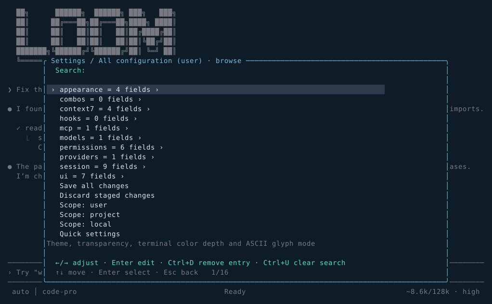
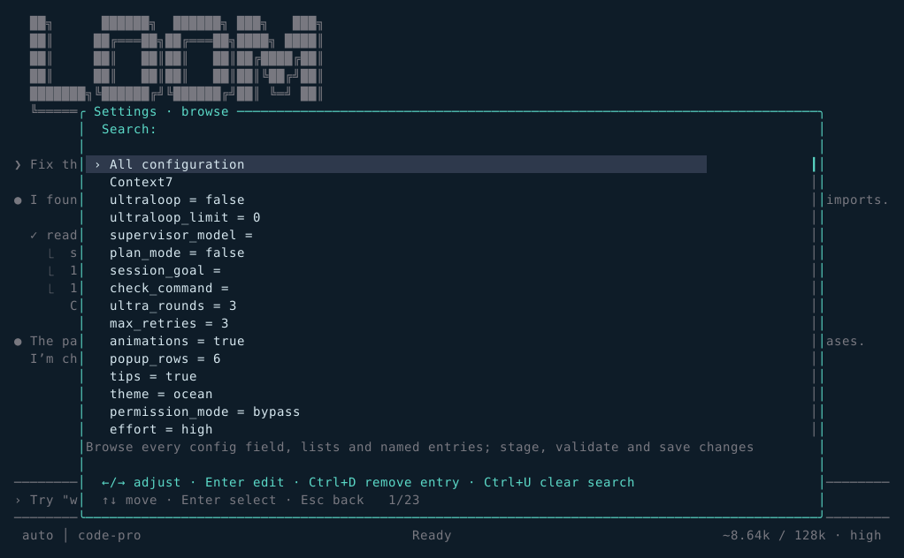
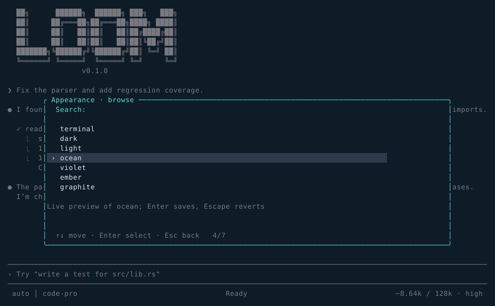
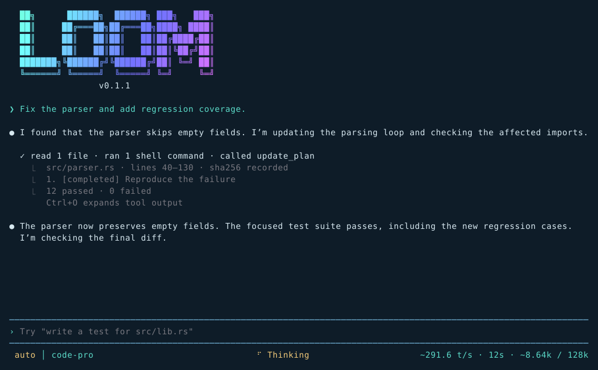
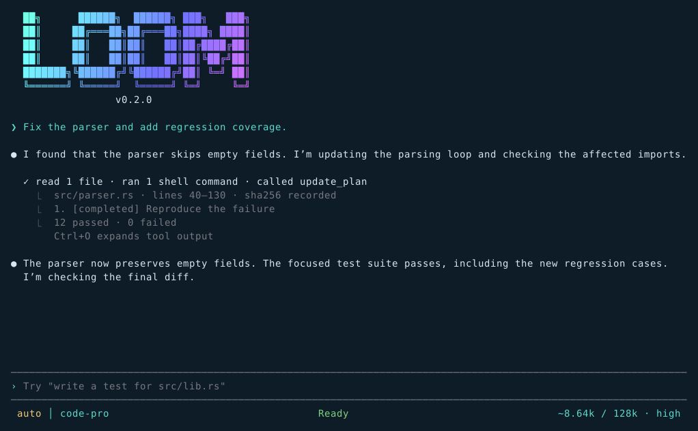
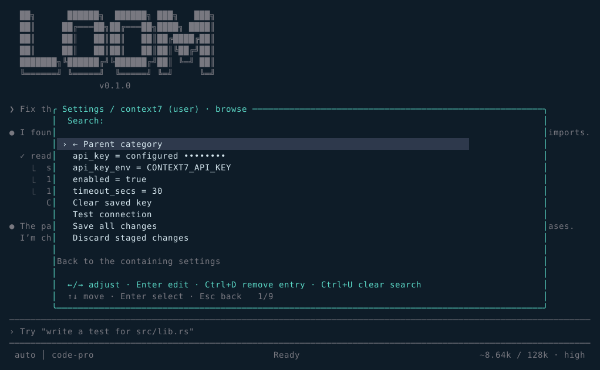

<div align="center">


# Loom

**A terminal-native coding agent you can inspect.**

Any [OI]-compatible endpoint · durable plans · an independent completion supervisor ·
an append-only journal you can replay

[](https://github.com/rawnullbyte/LoomCode/actions/workflows/ci.yml)
[](https://rawnullbyte.github.io/LoomCode/)
[](LICENSE)
[](Cargo.toml)

[Documentation](https://rawnullbyte.github.io/LoomCode/) ·
[Guide](#quickstart) ·
[Harness reference](docs/HARNESS.md)

</div>

---

Loom is a coding agent for your terminal. Point it at any endpoint that speaks the Chat
Completions or Responses protocol, hand it a goal, and it reads, edits, runs and verifies.
Every state change — messages, tool calls, file hashes, verification results — is written
to an append-only journal, and the transcript is only a projection of it. That is the whole
design premise: **an agent you can replay, rewind and audit** instead of one you have to trust.

The executable is **`loom`**. New installations use `loom` configuration paths; existing
`loon` configurations are reused for compatibility.

## Why it is different

| | |
| --- | --- |
| **Replayable by construction** | The journal is authoritative. Sessions resume to the exact context they held, and a rewrite of history is visible rather than silent. |
| **Your endpoint, not a vendor list** | Chat Completions and Responses are both first-class. Arbitrary base URLs work, including local models and gateways with no discovery and no tool calling. |
| **Supervision that can say no** | An independent reviewer reads the goal, plan and evidence. It cannot accept completion while plan items are open or required verification fails. |
| **Edits with a paper trail** | Hash-protected writes reject stale edits, patches are atomic, and mutations keep undo metadata. Conflicts are reported, never clobbered. |
| **Persistent processes** | A named shell keeps its working directory and exports. Monitors stream long builds. SSH multiplexes one authenticated session. |
| **Honest numbers** | Token counts are labelled estimates until the provider reports real usage. No invented progress percentages. |

## Quickstart

Rust 1.75 or newer. No credentials are needed for the first run — the bundled provider is a
deterministic mock.

```sh
cargo build --release
./target/release/loom

# Install the command locally:
cargo install --path crates/loon-cli --force

# Offline smoke test (the default provider is a deterministic mock):
loom run "Say hello" --output text
```

Then connect a real endpoint from inside the TUI:

```text
/providers add local http://127.0.0.1:11434/v1
/model local/my-model
```

Providers are usable immediately after saving; restarting is unnecessary. An endpoint
without model discovery can still be used as `/model PROVIDER/MODEL_ID`.



## What it looks like

Every image below is rendered from the real Ratatui widgets with sample data — not a
mockup. Regenerate them with `cargo run -p loon-tui --example preview -- docs/previews`.

| | |
| --- | --- |
|  |  |
| **Models** — recent selections, per-provider search, combos | **Providers** — add, test, refresh, remove |
|  |  |
| **Configuration** — every typed field, staged and validated | **Settings** — arrows adjust, Enter edits |
|  |  |
| **Appearance** — seven palettes preview live | **Activity** — thinking, writing and tools distinguished |
|  |  |
| **Workspace** — what this session changed | **Documentation** — library docs with masked keys |

## Management

| Command | Behavior |
| --- | --- |
| `/model` | Home with five recent selections, provider entries, combos and global search |
| `/model PROVIDER` | Search models inside one provider |
| `/model all` | Browse every discovered model |
| `/model PROVIDER/MODEL_ID` | Select a model, including an unlisted model |
| `/providers` | Browse, add, edit, refresh/test and remove providers |
| `/providers refresh all` | Fetch model catalogs concurrently, retaining cached models on failure |
| `/providers add NAME URL [KEY] [chat\|responses] [KEY_ENV] [LEVELS]` | Add an endpoint directly; use `-` for an omitted optional value |
| `/providers key-clear NAME` | Remove saved inline/environment credentials for that provider |
| `/combos` | Manage ordered fallback or round-robin groups |
| `/combos add NAME round_robin provider/model provider/model` | Create a rotating group; `fallback` is also supported |
| `/settings`, `/config` | Quick preferences and a complete configuration browser; arrows adjust values, Enter edits |
| `/config KEY=VALUE` | Validate, apply and persist a setting (`/config tips=true`) |
| `/config KEY VALUE` | Same, for values containing spaces; `/config set KEY VALUE` also works |
| `/config KEY` | Show one setting and its description |

### Ultra Loop and Ultra Code

`/ultraloop GOAL` starts a task with an independent completion supervisor. When the main
agent stops, the supervisor reads the goal, durable plan, recent tool results and the
agent's explanation. It sends concrete next steps back when the work is unfinished,
including when the main agent claims it cannot do the task. Repeated invalid tool calls can
also be redirected by the supervisor. Completion requires an explicit verdict with evidence;
unfinished plan items and failing required verification prevent it.

```text
/ultraloop Implement the API, add regression coverage and get the tests passing
/ultraloop status
/ultraloop model cloud/reasoner
/ultraloop limit 0
/ultraloop off
/ultracode Fix the parser and verify every supported input format
```

Reviews are unlimited by default (`limit 0`). Set a positive review limit to bound a run.
**Esc cancels the current turn**; `/ultraloop off` disables further reviews, including while
a turn runs. `on` enables review for the next/current task. `model default` returns to the
main model with a separate context. State survives `/resume`; `/new` starts fresh.

A review that does not come back as a valid verdict is repaired rather than thrown away: a
reply cut short by the output limit is re-asked with a larger budget, and a reply the parser
rejects is re-asked with the rejected text and the reason it failed, up to three requests.
If no usable verdict arrives, the turn fails with the reason and the goal is recorded as
unverified on the plan, so it stays visible instead of quietly dropping out of review. The
same policy covers context compaction, which asks the model through the same path.

A goal that declines its own verification — `/ultraloop do not verify the goal`, or any
wording telling the supervisor to never stop — is treated as binding. The supervisor is told
about it, and if it returns `completed` anyway the verdict is replaced with `continue` and the
override is journaled, so the run does not stop on a review that ignored the instruction.
The refusal is read from the goal text itself, so it survives `/resume` and a supervisor model
swap. A plain status report such as "not done yet" is not a refusal.
`/ultracode` sets maximum coding effort, and an optional task starts immediately. The
supervisor never overrides cancellation or permission rules. Provider/network failures and
unusable reviewer responses are reported as failures, never successful completion.

You can also require a concrete verification command:

```text
/config check_command=cargo test
/config ultra_rounds=3
```

The command runs through the normal tool/permission path after the agent stops. Failures
return their output to the main agent. After the repair budget, an ordinary turn fails
honestly; with Ultra Loop enabled, the supervisor can propose another approach and continue.
`ultra_rounds=0` or an empty command disables this check. Verification calls and results are
persisted together, so resumed sessions retain valid tool-call history.

Headless runs support the same supervisor:

```sh
loom run "Implement the API and verify it" --effort ultra --ultraloop \
  --supervisor-model cloud/reasoner --ultraloop-limit 20 --output jsonl
```

Ctrl+C cancels a headless run. Omit the supervisor model to use the current model, and omit
the limit for unlimited reviews.

### Tools, prompts and feedback

`/tools` opens the live tool browser, including MCP tools, descriptions and parameter
schemas. The standard set includes:

| Tool | Purpose |
| --- | --- |
| `read`, `write`, `edit`, `fuzzy_edit`, `multi_edit` | Bounded reads and protected edits with undo metadata |
| `apply_patch` | Atomic single-file unified diff, with exact context and stale-write protection |
| `grep`, `glob`, `tree` | Targeted search and overviews; glob/grep honor ignore files without requiring Git metadata |
| `bash` | Bash syntax, development/toolchain environment, separate stdout/stderr and process-group cleanup |
| `process` | Start, list, poll or stop managed background builds and servers; incremental cursors and bounded logs |
| `shell_session` | One long-lived shell per named session, reused across calls so `cd`, exports and activated virtualenvs persist; per-call exit status and timeout |
| `monitor` | Watch a long-running process: incremental polls, `wait_for` regex with timeout, bounded log tail, real exit status |
| `ssh` | Persistent SSH via OpenSSH ControlMaster: connect once, then every command reuses the same authenticated session |
| `fetch` | Bounded HTTP(S) text retrieval for documentation, APIs and source files |
| `list_directory`, `file_info`, `read_many`, `find_symbol`, `project_info`, `file_compare` | Repository inventory, batched reading, declaration search and comparisons |
| `read_json`, `json_edit`, `notebook_read`, `notebook_edit` | JSON-pointer operations and notebook cell edits with stale-write protection |
| `git_status`, `git_diff`, `git_log`, `git_show`, `git_blame`, `git_branches` | Read-only Git inspection with literal paths and bounded output |
| `run_tests`, `run_build`, `run_lint` | Project-aware Cargo, Node, Go and Python checks through normal permissions |
| `context7_search`, `context7_resolve_library`, `context7_query_docs` | Current library documentation via Context7; credentials configurable in Settings |
| `todo_read`, `todo_write`, `update_plan`, `task`, `note` | Durable checklists, task dependencies, evidence and working notes |
| `load_skill`, `memory`, `read_output`, `tool_search` | Coding workflows, persistent facts, full output and MCP discovery |

Managed processes use pipes rather than an interactive PTY. Patch calls target one explicit
file and do not delete files. Fetch returns source text and does not execute JavaScript.
Compatible-endpoint aliases such as `exec_command`/`cmd` and `read_file`/`file_path` are
normalized before validation, and canonical fields take precedence. Calls/results stay
paired across multiple rounds and interrupted turns. Malformed arguments return corrective
feedback, and repeated failures are bounded unless the supervisor redirects the run.

The system prompt directs the agent to load relevant coding skills, read existing todos,
record every requirement before multi-step implementation, keep one item in progress, and
update the checklist as work proceeds. Findings, changed paths, failed attempts,
verification evidence, blockers and next actions belong in durable notes. Compaction
preserves this working state. These are model instructions backed by persistent tools;
unfinished todos also prevent the supervisor from accepting completion.

### Terminal interface

Failures show the actual command and diagnostic, even inside a collapsed group. **Ctrl+O
expands tool output**; Ctrl+Y copies the last assistant answer. Multiline paste keeps its
original lines and the input viewport follows the caret.

File mutations show **what changed**, not just that something happened: `edit`, `fuzzy_edit`,
`multi_edit` and `write` append a bounded unified diff to their result, and the transcript
colours it — removals red, additions green, hunk headers yellow, with `+N −M` as the summary
for a collapsed run. The diff is clipped after 60 changed lines per side (120 for a full
rewrite) and says so rather than truncating silently; a rewrite that changes nothing
produces no diff at all. Every stored
diff line keeps its own row, so colouring stays per-line no matter how large the edit is.
The same colouring applies to a diff pasted into an assistant answer.

Fenced code blocks are **syntax highlighted** by their fence tag — Rust, Python,
JavaScript/TypeScript/Go/Java, shell, JSON and TOML — with keywords, strings, numbers and
comments styled separately. The highlighter is a tolerant lexer rather than a parser: an
excerpt cut mid-string still renders, and highlighting never changes the underlying text,
so copying a command out of the transcript yields exactly what was shown. An unknown fence
tag falls back to plain code. File reads get the same treatment from their path, so a
`read` of `lib.rs` renders with Rust highlighting and a `.txt` file is left alone; a diff
always keeps its red/green rather than being re-tokenized as source. One request-level `t/s` counter
covers thinking, writing and tool arguments together. `~` marks a character-based estimate
until the provider reports total output/completion tokens. Reasoning tokens are not added
again. The timer includes request latency, resets on each request/retry and freezes during
tool execution.

Animation includes the banner, tool spinners, streaming cursor, pulsing active-input/modal
borders, modal entrances and an activity scanner. `/config animations=false` disables
motion. `/config popup_rows=10` adjusts slash suggestions. `/theme` previews terminal, dark,
light, ocean, violet, ember and graphite palettes while you navigate. Enter saves; Escape
restores the prior palette.

All management lists support typing to search, arrows, mouse wheel, Page Up/Down,
Home/End, Enter or click, and Escape to clear search/go back. Editors support
Tab/Shift+Tab, cursor movement, bracketed paste and **Ctrl+S to save**. API keys are masked.
Blank credentials in an edit retain the current key; a key environment variable takes
precedence when set through the editor.

Provider model IDs are namespaced, so identical IDs from different providers do not collide.
Discovery accepts a `data` or `models` array, a bare array, and paginated `has_more`
catalogs. A pasted `/responses`, `/chat/completions` or `/models` endpoint is normalized to
its API base. Authentication, malformed responses and transport failures remain visible.

### Configure everything from the UI

Open `/settings` → **All configuration** to browse appearance, UI behavior, session
defaults, permissions, providers, named models, combos, MCP servers, lifecycle hooks and
Context7. Each field has its own row/editor, with nested collections for headers,
environment entries, model lists, routing members and rules. Left/Right adjusts
choices/numbers, Enter edits text, **Ctrl+D** removes a selected collection entry, and
Escape returns to the previous page. Add entries with **+ Add entry**.

Changes in this browser are staged. **Save all changes** validates and applies them without
closing the menu; **Discard staged changes** restores saved values. Errors and connection
results appear inside the menu. Quick settings also expose per-session Ultra Loop, review
limits, reviewer model, plan mode and the persistent goal.

The browser has **user**, **project** and **local** scopes. Project/local saves write sparse
overrides to `.loon/config.toml` / `.loon/config.local.toml`; unchanged fields keep
inheriting parent defaults. Comments and unknown extensions survive edits. Removing an
inherited named entry requires selecting its parent scope. Clearing an optional overlay
value restores inheritance. An external config change blocks saving until the draft is
reloaded.

### Context7 documentation tools

Open `/settings` → **Context7**, or `/context7`, to configure **enabled**, **API key**,
**key environment variable** and **timeout**. Enter a masked key, choose **Test
connection** to test the draft, then **Save all changes**. The running tools update
immediately. Blank key input keeps the saved credential; use the **clear** action or
**Clear saved key** to remove it.

Environment credentials are optional and take precedence over a saved key:

```sh
export CONTEXT7_API_KEY='your-key'
loom
```

Saved keys are masked in the UI, excluded from status/event output, and written to the
selected configuration file with 0600 permissions on Unix. Use the user or local scope for
credentials. The agent can search documentation directly or resolve a library and query its
docs at the relevant version. It falls back to official URLs through `fetch` when Context7
is unavailable.

For other documentation servers, use `/mcp` or `/settings` → **All configuration** →
**mcp**. HTTP servers can be configured by port/URL; stdio servers expose command,
arguments, environment and timeout. Saving server changes reconnects the live catalog.

## Sessions and working state

| Command | Behavior |
| --- | --- |
| `/sessions`, `/resume` | Search saved session titles, IDs and workspace paths |
| `/resume ID_OR_PREFIX`, `/resume N` | Restore a session and its transcript; ambiguous prefixes are refused |
| `/new`, `/clear`, `/rename TITLE` | Start a saved session (`/clear` is an alias) or name the current one |
| `/delete ID_OR_PREFIX`, `/delete N` | Delete a saved session and its journal; the session you are in is refused |
| `/todos` | Browse/add/edit tasks and change pending, in-progress, completed or blocked state |
| `/todos add TEXT`, `/todos start N`, `/todos done N` | Manage a plan directly |
| `/notes` | Browse/add/edit/remove durable session working notes |
| `/notes add TEXT`, `/notes remove N` | Manage notes directly |
| `/goal TEXT` | Set a persistent session objective; `/goal clear` removes it |
| `/memory [global\|workspace] [TEXT]` | Cross-session facts and preferences |
| `/compact`, `/autocompact 50k\|on\|off\|auto`, `/context` | Context management and usage estimates |
| `/skills`, `/workflows` | Reload/list bundled and custom workflows |
| `/mcp` | Manage MCP servers: add, edit, reconnect, remove, inspect tools |

Plans, notes, the goal, selected model and effort are stored separately from the compacted
transcript. A bounded working-state excerpt is included in every request. Compaction
preserves recent exchanges, can shorten a long tool-heavy turn, and retains original history
if summarization fails, is empty, fails to shrink it or cannot be journaled.

Sessions are created by their first message, not when Loom starts: opening the app and
quitting without sending anything leaves nothing behind in `/resume`. Work state follows the
session the same way, so a message-less session cannot leave an orphaned plan or notes file.

From the shell, the same journal is inspectable without the TUI:

```sh
loom sessions list                     # most recently used first
loom sessions export ID                # every event of one session as a list
loom sessions delete ID                # asks you to type the id prefix to confirm
loom sessions delete ID --force        # no prompt (scripts)
loom resume ID "next task"             # continue a saved session headlessly
```

Every command that takes an `ID` accepts either the full id or any unique prefix of it, so
the short ids printed by `sessions list` are directly usable. An ambiguous prefix lists the
candidates instead of guessing, and an empty one is refused.

Sessions are ordered by **last activity**, not by creation: the session you messaged five
minutes ago is at the top, even if others were created after it. `sessions list` shows both
`LAST USED` and `CREATED` so the order is self-explanatory. `/resume` in the TUI uses the
same order and annotates each entry with its age ("5m ago", "2h ago").

Deleting removes the session row and its events in one transaction. An unknown id is
reported by name rather than as a file-system error, and the session you are currently in
cannot be deleted.

`loom resume` accepts a full id or a unique prefix; an ambiguous prefix lists the candidates
instead of guessing. It reuses the same code path as `loom run`, so prompt files, model
overrides, output modes and exit codes behave identically.

There are **26 embedded coding workflows**, available without installing files:
`/implement`, `/debug`, `/review`, `/handoff`, `/refactor`, `/test`, `/optimize`, `/audit`,
`/document`, `/backend`, `/frontend`, `/api-design`, `/database`, `/migrations`, `/devops`,
`/dependency-upgrade`, `/repository-explore`, `/docs-research`, `/rust`, `/python`,
`/typescript`, `/go`, `/security-review`, `/test-repair`, `/release` and `/performance`. See
[their bundled instructions](crates/loon-core/skills/). Custom workflows can be a Markdown
file or a `NAME/SKILL.md` directory in `.loon/skills/` or the global data directory's
`skills/`. Workspace files override global and bundled names. Use `{{args}}` for
slash-command arguments. The agent's `load_skill` tool reads workflows on demand.

## Agent tools and effort

The agent can inspect/search files, make hash-protected edits, run commands, use MCP tools,
delegate scoped subtasks, maintain its checklist with `todo_read`/`todo_write` (sharing state
with `update_plan`), track dependent tasks with `task`, write working notes with `note`, and
persist facts with `memory`. Independent consecutive read-only tools run concurrently (up to
six); mutating operations remain ordered. Truncated full output has a blob hash and can be
inspected or searched through `read_output` without rerunning the command.

The system prompt directs the agent to inspect before changing files, implement action
requests fully, maintain useful plans, record decisions/blockers, verify changes and
distinguish actual results from untested claims. These instructions guide behavior; they do
not guarantee the quality of an arbitrary model.

| Effort | Per-request output budget | Preferred wire reasoning level |
| --- | ---: | --- |
| low | 4,096 | low |
| medium | 8,192 | medium |
| high | 16,384 | high |
| xhigh | 32,768 | xhigh |
| ultra | 65,536 | max |

Configured model output limits cap these budgets. For compatibility, reasoning parameters
are omitted unless the provider's `reasoning_efforts` lists accepted wire values, for example
`['low', 'medium', 'high', 'xhigh', 'max']`. Routing selects the closest supported level at
or below the requested level. [OI]-compatible endpoints vary in support; `ultra` is an
application setting, not a universal wire value. Chat uses `reasoning_effort`, Responses uses
`reasoning.effort`.

```toml
[session]
model = "local/my-model"
effort = "high"

[providers.local]
base_url = "http://127.0.0.1:11434/v1"
api = "chat"
# api_key_env = "LOCAL_API_KEY"
# reasoning_efforts = ["low", "medium", "high"] # only when supported
```

Headless usage: `loom run "Fix the parser" --model local/my-model --effort high --output jsonl`.
A turn has no step limit: it runs until the model finishes, the turn fails, or you cancel it.
Exit codes: 0 completed, 1 failed, 2 cancelled, 64 invalid usage/config. JSONL includes
thinking activity, tools, plan updates and turn lifecycle events. Token counts shown as
estimates use a heuristic.

`--output` has three distinct modes: `text` (default, for humans), `jsonl` (one event per
line, for streaming), and `json` (a single document with `session`, `events` and `turn`, for
a consumer that parses once). `json` is not line-delimited: `json.load` on it succeeds.

The opening banner is a multi-line loom drawn in the transcript — a frame with warp threads
and leaves falling through it — so it scrolls away as the conversation grows instead of
occupying a fixed row. The status bar along the bottom leads with the colour-coded permission
mode (bypass in red, auto in yellow, ask in green, allowlist in cyan), then the model, the
live activity, the elapsed time of the current prompt and the current request's combined
throughput in tokens per second, plus the queue depth. Reasoning events show thinking
activity when the provider supplies them; waiting, writing and tool execution are
distinguished. The UI does not invent progress percentages.

## Copying and controls

- **Enter** sends, **Shift+Enter** starts a new line, **Ctrl+Enter** cancels the running request and sends immediately. **Ctrl+Backspace** deletes the previous word. These need the terminal's progressive keyboard protocol; Loom enables it automatically when supported.
- In the prompt, **Ctrl+Left/Right** moves by a word (the same boundaries Ctrl+Backspace deletes), **Shift+arrows** select text, and **Ctrl+Shift+arrows** select a word at a time. Typing or Backspace replaces the selection, and **Ctrl+C** copies it. Clicking anywhere in a multi-line prompt puts the caret on that line and column.
- **Esc** twice stops the running turn immediately; a prompt typed while a turn runs is queued, and **Up** on an empty input pulls the newest queued prompt back for editing.
- Drag a transcript selection to copy; the selected cells are highlighted with a grey background. **Ctrl+Y** copies the last assistant block directly from its source text.
- Copy preserves source indentation/newlines and Unicode; visual wraps, prompt labels, ANSI escapes and the streaming caret are excluded. The selection uses a stable snapshot while output streams.
- Native clipboard helpers are attempted first with closed stdin and bounded waits; OSC 52 is the fallback for remote terminals. Clipboard behavior still depends on terminal/desktop support.
- Escape or Ctrl+C cancels an active operation. Page Up/Down and the wheel scroll the transcript outside management lists. **Shift+Tab** cycles permission modes; explicit denies always apply.
- Permission modes are `bypass`, `auto`, `ask`, `allowlist`. Changing a mode updates the actual gate. The original default, `bypass`, is retained.

## Validation

```sh
cargo test --workspace --no-fail-fast
cargo clippy --workspace --all-targets -- -D warnings
cargo fmt --all --check
# Recreate the actual-widget SVG previews with sample data:
cargo run -p loon-tui --example preview -- docs/previews
# Build and verify the documentation site:
python3 docs/site/build.py --check
```

Tests include local HTTP discovery fixtures, duplicate provider IDs, pagination/auth errors,
reasoning wire formats, live combo switching and rotation, plan/note resume, failed
compaction, concurrent tool replay, streamed-text backpressure, immediate follow-up prompts,
cancellation after resume, small-terminal modals, secret masking and
Unicode/indentation-preserving copying. They do not use live paid-provider credentials.

`LOON_HOME=/path` keeps config/data/state isolated. Existing config and session paths are
retained.

Two commands keep setup honest. `loom doctor` prints environment and tool diagnostics
entirely offline unless you pass `--connect`, and exits non-zero when something is wrong:

```sh
loom doctor                # paths, terminal, tools, providers, config — all offline
loom config path           # where the config file lives
loom config validate       # parse the config and show every finding
loom config init            # write the commented example config (never overwrites)
```

## Documentation site

The documentation in this repository *is* the website. `docs/site/build.py` renders the
Markdown you are reading, plus [docs/HARNESS.md](docs/HARNESS.md), into a static site with
no third-party dependencies. The
GitHub Actions workflow deploys it to Pages on every push to `main`.

```sh
python3 docs/site/build.py --check   # build to docs/site/_out and verify links
```

Because the site is generated from the same files, the documentation cannot drift from the
repository.

## Harness extensions

See [the harness guide](docs/HARNESS.md) for HTTP MCP by port/URL, deferred tool discovery,
lifecycle hooks, durable task dependencies, agent profiles/worktree isolation, scoped rules,
plan mode, permission precedence and supported boundaries. Resize redraws retain drafts and
modal selection. Rewind removes the chosen message and later chat, and restores its original
text for editing.

## License

MIT — see [LICENSE](LICENSE).
